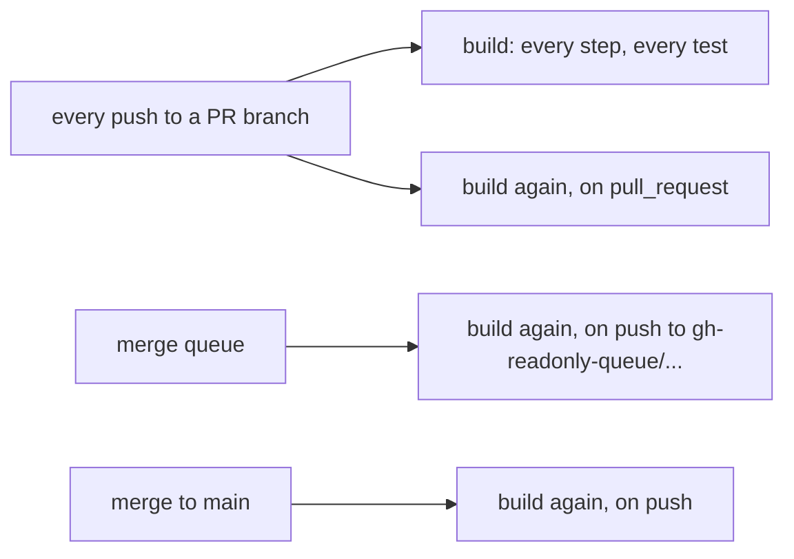
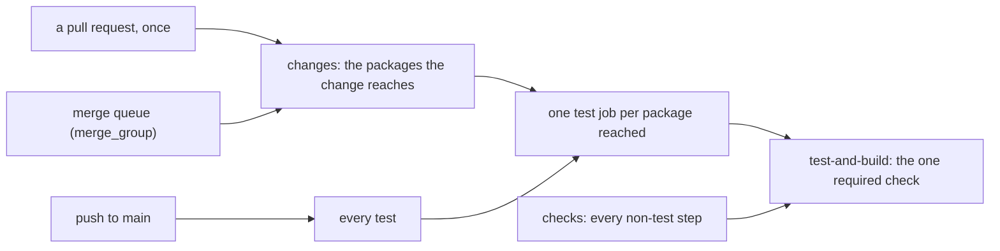

# 0036 — A pull request builds once, its tests follow the packages its change reaches, and one verdict job is the check main requires

**What this decides:** how `.github/workflows/build.yaml` starts: one build per event, only the test
jobs a change can reach, and one job named `test-and-build` that the `main protection` ruleset
reads.

**Before:**

**After:**

## Context

Measured 2026-11-13 with `gh`:

- `build.yaml` triggered on `push` and `pull_request`, both for every branch. Every push to a PR
  branch started the build twice, the merge queue ran it again as a `push` on its
  `gh-readonly-queue/...` branch, and main ran it again: four builds per merged PR.
- One build is about 12 minutes. In PR run 43527511161 "Run tests" took 10.2 minutes and every other
  step together under 2. A runner never waited (median 0.1 minute), so the cost is what we run.
- Opened to merged, over the last 60 merged PRs: median 45.7 minutes, of which about 12 is the PR
  build and 11.4 the same build again in the queue.
- Summed test-file time: `packages/code-graph` 9.8 minutes, `packages/structure-sweep` 5.5,
  `packages/tea` 4.7.

The shape comes from Umut's `usirin/tea-fabrika` (`.github/workflows/check.yaml`,
`.github/ci/changes.mjs`, `.github/ci/required.mjs`, its decisions 0174 and 0175). Its path rules are
that repo's; the three ideas are taken: a PR runs once, a first job decides what runs, and one job
that never skips is the required check.

## Decision

**A pull request builds once, on its own event; the merge queue builds on `merge_group` and main on
`push`; each build starts only the test jobs its change can reach; and the job named
`test-and-build`, the context the ruleset already requires, passes a skipped job only when `changes`
said it may skip.**

- **One build per event.** `pull_request` has no `branches` filter, so a stacked PR whose base has a
  slash still runs. `push` runs on `main` only. `merge_group` (`checks_requested`) is the queue's
  trigger: GitHub's merge queue takes a required check only from it, and with `push` narrowed to main
  nothing else reports on a queue branch. A newer push to a pull request cancels the run it replaces
  (concurrency group by PR number, `cancel-in-progress` on `synchronize`). A merged PR is three
  builds: its head, its queue group, main.
- **`changes`, the first job** (`.github/ci/changes.mjs`), reads the changed files (a PR from its
  merge base with its base, a queue group from the group's base) and writes `legs`, the matrix of
  the `test` job, and `test`, whether any leg runs. A leg is one slice of the suite: a workspace
  package (`vitest run <package>/`, so every vitest project with a test file under it runs, tea's
  React and fast-check peer projects included) or the root's `scripts` project.
- **Which package a change reaches** is a package that holds a changed file and every package that
  depends on it, direct or not. pnpm reads that from each package.json (`pnpm ls -r --depth -1
  --json --filter "...{<dir>}"`, pnpm.io/filtering: "To select a package and its dependent packages
  (direct and non-direct), prefix the package name with an ellipsis"); no table of dependencies is
  written here. The root `scripts` leg joins any leg: its guards read every package's sources and
  test files.
- **Fail safe: whatever cannot be decided runs every test.** A push to main, an unknown event,
  unreadable or empty changed files, a `package.json` added or deleted (code-graph's tests list the
  workspace's members), and any path that is in no package and in no row of `READS`: the lockfile,
  `pnpm-workspace.yaml`, root configs, `vitest.config.ts`, `.github/**`, anything nobody wrote a rule
  for. If pnpm cannot list the workspace, one leg runs the whole suite.
- **`READS` is the list of files outside every package that a package's tests read**, from reading
  every test on 2026-11-13: tea's `public-subpaths.test.ts` searches every `.changeset/*.md`; tea's
  `doc-links.test.ts` checks that each repo-root path its Markdown links to exists. An addition or an
  edit cannot change what a test that only needs the file to exist sees; a deletion starts tea's leg.
  No test reads `ROADMAP.md`, `CLAUDE.md` or a root `README.md`. A package's own Markdown is never
  skipped: tea's docs are tested.
- **The other steps do not change.** `checks` runs every non-test step as the one job did (conflict
  markers, CODEOWNERS, catalog guard, typecheck, lint, docs drift, export stamps, API ratchet, build,
  the verify steps) on every build; they are cheap.
- **`test-and-build` is the verdict** (`.github/ci/required.mjs`). GitHub counts a skipped required
  check as passed, so it never skips (`if: always()`), needs every other job, and judges each: a job
  passes by succeeding, or by skipping when `changes` wrote exactly `"false"` for it. The ruleset's
  required context stayed `test-and-build`, so it was not edited.
- **The scripts live in `.github/ci/`**, a governed root: `.github/` is owned by
  `@kamp-us/control-plane`, so a change to what main requires is reviewed there. Their tests run in
  the root `scripts` vitest project.

**Binding constraints.**

- `build.yaml` keeps a `merge_group` trigger while the `main protection` ruleset requires a check.
  `.github/ci/workflow.test.mjs` fails otherwise.
- Exactly one job is named `test-and-build`, it is the verdict, and it needs every other job.
- A job the verdict lets skip starts only on `changes`' exact answer, and a job that must not skip
  has no `if`. A new job joins the verdict's `needs`.
- A test that starts reading a file outside its package adds its row to `READS` in the same change.
- Main's push runs every test and is not narrowed.

## Consequences

- A PR that touches only `packages/tea/` starts tea, the packages that depend on it
  (`structure-sweep`, `backlog-sweep`) and the root leg, and not code-graph. It does not skip
  structure-sweep: both sweeps declare `@demlik/tea` as `workspace:*` and their vitest configs read
  tea's `src/`. A code-graph change starts every package, since tea declares code-graph as a
  devDependency. A decision, a pattern or the roadmap alone starts no test job.
- **The cost, said plainly:** a queue run follows its paths, so a break in a test it skipped shows on
  main's own run after the merge, which runs every test. That is the net Umut's 0175 gave up and this
  keeps. A package that reads another's files without declaring the dependency escapes the selection
  until main's run; the audit found none today (every cross-package read matches a `workspace:`
  edge).
- Every leg installs the workspace, so a build that runs many legs spends more runner minutes in
  installs than before. What a pull request waits for falls to its slowest leg.
- tea-fabrika, phoenix and demlik each hold a copy of the changed-files and verdict scripts. Demlik's
  is plain Node with an injected runner, as tea-fabrika's is, so it can move into the fabrika CLI
  whole.

## Not decided

- Sharding a leg (code-graph is the slowest).
- Skipping the non-test steps of `checks` for a change that cannot reach them.
